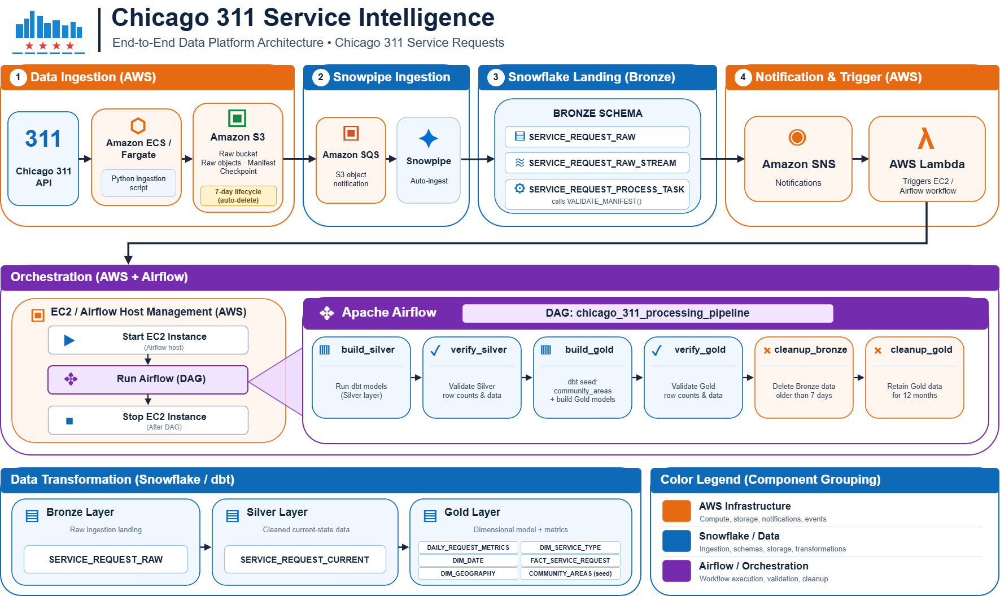
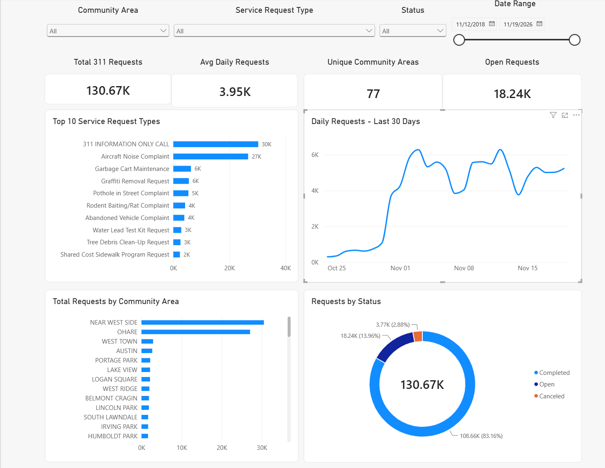

# Chicago 311 Service Intelligence

**An event-driven data engineering platform for ingesting, validating, transforming, and analyzing Chicago 311 service requests.**

This portfolio project demonstrates an end-to-end data pipeline built with **Python, AWS, Snowflake, Apache Airflow, and dbt**. It collects public service-request data from the City of Chicago, lands it in cloud storage, ingests it into Snowflake, and prepares validated dimensional data for analytics.

The design emphasizes **reliable batch processing, clear data-quality checkpoints, separation of raw and analytical data, and cost-conscious infrastructure**.

## Architecture

**Pipeline at a glance:**

`Chicago 311 API → ECS Fargate → S3 → SQS → Snowpipe → Snowflake Bronze → Stream / Task → SNS → Lambda → EC2 / Airflow → dbt Silver + Gold`

The architecture includes retention and cleanup controls: seven-day retention for raw S3 and Bronze data, and a rolling 12-month horizon for Gold data.

## What the platform does

1. **Extracts service requests** from the Chicago 311 API using a Python ingestion job running on Amazon ECS Fargate.
2. **Stores raw data, manifests, and checkpoint information** in Amazon S3. Manifests support batch-completeness validation; checkpoints support ingestion progress tracking.
3. **Loads raw records into Snowflake** through S3 event notifications, Amazon SQS, and Snowpipe auto-ingest.
4. **Validates landed data** using a Snowflake stream and task, with the task calling `VALIDATE_MANIFEST()`.
5. **Triggers downstream processing** through Amazon SNS and AWS Lambda, which initiate the EC2-hosted Airflow workflow.
6. **Builds analytical tables** with dbt, verifies Silver and Gold outputs, and runs retention cleanup tasks through Airflow.

## End-to-end architecture

### 1. Data ingestion: Python, ECS Fargate, and S3

The ingestion component retrieves public Chicago 311 service-request records from the source API. The Python job runs as a containerized ECS Fargate task and writes raw objects to S3 along with batch manifests and checkpoint information.

**Why this matters:** Compute for ingestion runs only when needed; object storage keeps source data separate from downstream transformations; manifests give later stages a way to determine whether a batch arrived completely.

### 2. Automated warehouse ingestion: SQS and Snowpipe

New S3 objects produce notifications routed through Amazon SQS. Snowpipe uses the queue notifications to automatically ingest the newly arrived objects into Snowflake.

This decouples file arrival from warehouse loading and avoids requiring Airflow to poll S3 and manually issue each raw-data load.

### 3. Bronze landing and batch validation: Snowflake

The Bronze schema preserves ingested source records in `SERVICE_REQUEST_RAW`.

- `SERVICE_REQUEST_RAW`: raw landing table.
- `SERVICE_REQUEST_RAW_STREAM`: stream tracking changes to the landing table.
- `SERVICE_REQUEST_PROCESS_TASK`: Snowflake task that calls `VALIDATE_MANIFEST()`.

The manifest-validation stage acts as a gate before downstream processing is initiated. Its role is to prevent a partially arrived batch from being treated as ready for transformation.

### 4. Event notification and workflow trigger: SNS and Lambda

After Bronze readiness is established, an Amazon SNS notification feeds an AWS Lambda function. Lambda initiates the EC2/Airflow processing workflow.

Airflow runs on an EC2 host that is started for processing and stopped after the DAG completes, rather than remaining online continuously.

### 5. Orchestration: Apache Airflow

The `chicago_311_processing_pipeline` DAG manages dbt transformations, validation, and cleanup in the following sequence:

| Task | Responsibility |
| --- | --- |
| `build_silver` | Runs dbt models for the cleaned Silver layer. |
| `verify_silver` | Checks Silver data and row counts. |
| `build_gold` | Loads the `community_areas` dbt seed and builds Gold models. |
| `verify_gold` | Checks Gold data and row counts. |
| `cleanup_bronze` | Removes Bronze data older than seven days. |
| `cleanup_gold` | Maintains a rolling 12-month Gold-data horizon. |

The validation tasks separate **building** a layer from **checking** its output. Cleanup is positioned after transformation and verification in the documented workflow.

## Analytics Dashboard

The Gold-layer data is consumed by Power BI to
visualize Chicago 311 service request activity.

## Data model: Bronze, Silver, and Gold

| Layer | Purpose | Principal objects |
| --- | --- | --- |
| **Bronze** | Raw ingestion landing with source-level records. | `SERVICE_REQUEST_RAW` |
| **Silver** | Cleaned, current-state service-request records for downstream modeling. | `SERVICE_REQUEST_CURRENT` |
| **Gold** | Analytics-ready dimensional structures and daily metrics. | `FACT_SERVICE_REQUEST`, `DIM_DATE`, `DIM_SERVICE_TYPE`, `DIM_GEOGRAPHY`, `DAILY_REQUEST_METRICS` |

The Gold build also uses the `community_areas` dbt seed as reference data.

**Why separate the layers?** Bronze retains the ingestion representation, Silver establishes a clean and consistent operational view, and Gold organizes data around reporting and analytical questions. This keeps API ingestion concerns separate from transformation and presentation concerns.

## Data quality and processing safeguards

The architecture includes several explicit verification points:

- **Batch completeness:** S3 manifests and Snowflake's `VALIDATE_MANIFEST()` step gate downstream execution.
- **Bronze change detection:** A Snowflake stream and task coordinate readiness evaluation after landing.
- **Silver validation:** Airflow's `verify_silver` task checks row counts and transformed data.
- **Gold validation:** Airflow's `verify_gold` task checks row counts and analytical outputs.
- **Retention controls:** Raw S3 objects and Bronze records have seven-day cleanup policies; Gold data is designed around a 12-month window.

These are architectural safeguards, not claims of guaranteed exactly-once delivery, automatic recovery from every failure, or a production service-level agreement.

## Key design decisions

| Decision | Rationale |
| --- | --- |
| **ECS Fargate for extraction** | Runs containerized Python ingestion without managing a persistent ingestion server. |
| **S3 raw objects plus manifests** | Separates source capture from transformation and provides a batch-completeness checkpoint. |
| **SQS + Snowpipe** | Uses event-driven ingestion rather than an Airflow-based file-polling process. |
| **Snowflake stream + task** | Evaluates newly landed data close to the warehouse before launching transformations. |
| **SNS + Lambda** | Connects warehouse readiness to downstream workflow initiation. |
| **Airflow on start/stop EC2** | Preserves DAG-based orchestration while reducing always-on compute time. |
| **dbt with Bronze/Silver/Gold separation** | Makes transformations modular and keeps analytical models separate from raw ingestion. |
| **Retention windows** | Limits storage growth in a portfolio environment while preserving a useful analytics history. |

## Technology stack

| Area | Technologies |
| --- | --- |
| Data source | City of Chicago 311 API / Open Data |
| Extraction | Python, Docker, Amazon ECS Fargate |
| Object storage | Amazon S3 |
| Event-driven ingestion | Amazon SQS, Snowpipe |
| Warehouse processing | Snowflake tables, streams, and tasks |
| Workflow events | Amazon SNS, AWS Lambda |
| Orchestration | Apache Airflow hosted on Amazon EC2 |
| Transformations | dbt, SQL |
| Analytical modeling | Silver current-state table; Gold fact, dimensions, and daily metrics |

## Analytical use cases

The Gold layer is designed to support questions such as:

- How does 311 request volume change over time?
- Which service types account for the most requests?
- How do request patterns differ across Chicago community areas?
- What daily trends and geographical patterns are visible in service requests?

These are intended analytical uses of the modeled data, not claims about specific findings or dashboard outputs.

## Tradeoffs and limitations

This is a **portfolio data platform**, not a claim of a fully hardened production service. In particular:

- The system uses multiple AWS and Snowflake services, which demonstrates integration patterns but increases operational complexity.
- Starting and stopping EC2 reduces idle compute costs, but introduces instance-startup latency and operational dependencies.
- Seven-day raw/Bronze retention and 12-month Gold retention deliberately limit historical reprocessing options.
- The diagram documents the processing path; deployment scripts, retry behavior, monitoring coverage, and infrastructure recovery procedures should be documented against the actual repository rather than assumed.

## Further improvements

Potential follow-on work includes automated deployment documentation, reproducible infrastructure provisioning, more extensive dbt tests, failure/retry scenarios, and centralized monitoring. These are improvement opportunities, **not features represented as already completed**.

## Data source

Public Chicago 311 service requests are published through the [City of Chicago Open Data Portal](https://data.cityofchicago.org/Service-Requests/311-Service-Requests/v6vf-nfxy).

## Project scope

This repository is intended to demonstrate the design and operation of a complete cloud data pipeline: ingesting a public API, using event notifications to load and validate data, orchestrating warehouse transformations, creating dimensional analytical outputs, and managing storage and compute costs.

## Data Source and Disclaimer

Data is sourced from the City of Chicago Data Portal.

This is an independent portfolio project and is not affiliated with or endorsed by the City of Chicago.

This site provides applications using data that has been modified for use from its original source, www.cityofchicago.org, the official website of the City of Chicago. The City of Chicago makes no claims as to the content, accuracy, timeliness, or completeness of any of the data provided at this site. The data provided at this site is subject to change at any time. It is understood that the data provided at this site is being used at one’s own risk.
